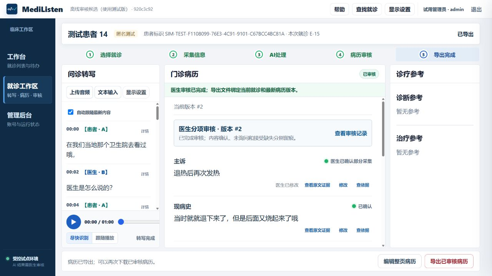
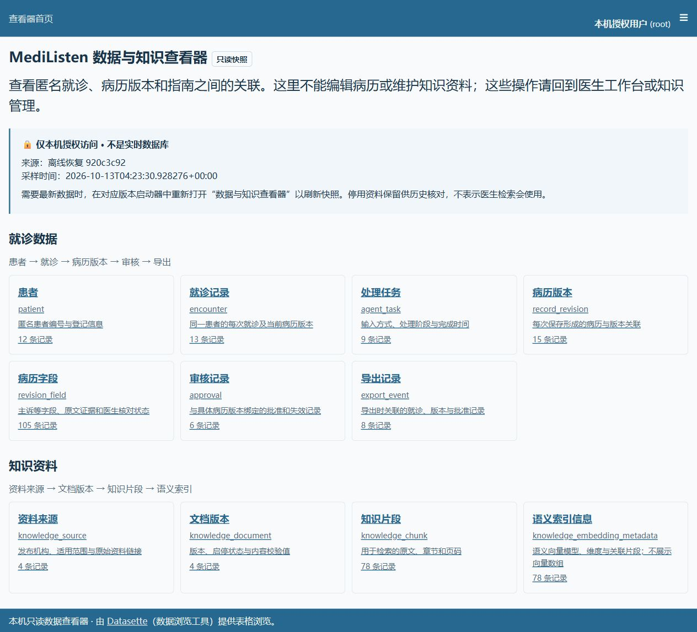

# 历史恢复、误导操作与知识索引范围核验

- 日期：2026-10-13；任务：Alpha 5.1 VERIFY。
- 运行基线：770bd920；开发修复基于3bbd13c。独立发布候选仅携带前端与帮助修复，不带入分支中的模型实验。
- 本轮11:18读取实时Planner：16项、99h，8 DONE、3 VERIFY、1 BLOCKED、4 BACKLOG；192个来源哈希匹配。

## 已复现及修复

1. 音频URL恢复仅加载ASR，未加载任务和Revision，还把状态改成TRANSCRIBED；统一为鉴权、就诊、任务版本、转写、审核导出读回链。
2. 迟到的导出状态或错误会污染新患者；增加就诊/任务/用户/Revision/加载代次核验，并取消旧读请求。
3. 恢复请求设置15秒期限，失败提供只读重试。正文先呈现，知识、轨迹独立加载。没有病历版本的进行中任务不查询导出审核状态。
4. 移除只显示成功提示、未写入数据的临床参考操作。真实查看、编辑、保存和审核保留。
5. 当前工作区URL保存就诊定位；刷新恢复原文和原版本，不重新调用模型。

## 本轮验证边界

修复前四项针对性用例均失败；修复后通过。新增恢复/竞态/超时/辅助失败/鉴权用例10项通过；真实隔离API和可见按钮的文本刷新测试通过，新增非GET请求为0。录音恢复、审核和报到回归保留。全量首轮769通过/7失败/2跳过，失败记录保留；旧断言已修订，生成阶段误查导出接口已修复，相关18项复核通过（分次运行）。最终发布候选全量、真实路径与恢复结果待后续追加，不预写PASS。

## 知识核验

运行库4启用文档、78片段、78向量元数据。既有开发20条及冻结20条未改标签，各20/20命中；实际hybrid_v1，200/200返回引用元数据完整。仅来源级工程检查，不代表临床正确率。

流感2020原PDF SHA256为693984e29ed67bdc0366f66c303f33b98847d0bcfcd6f1e87aa5cbbdcd8bfaac，与库中匹配，18个文件页面。初始索引覆盖文件页2–11（10页/10片段）；图像抽查文件页2对应印刷页3、文件页11对应印刷页12。page_count按导入实现统计索引页数，不是原PDF总页数。界面已更名，不修改该数值、片段或SHA。儿童指南限定儿童，索引不包含未转写流程图等内容；官网链接标明需联网，命中片段可离线查看。没有添加新资料或改启用组合。

## 数据与待验收

已在容器内备份源库；恢复8796只读查看器，13就诊/15Revision/6批准/8导出，标注8798与采样时间。原运行版及8795、旧归档保留。

物理麦克风与实际100%/125%/150%缩放继续待用户配合；5.1仍VERIFY、5.3不启动。模型首次错误不因前端修复或人工修订计为通过。正式任务、99h、日期及硬件延期不变；追加投入记R11。

## 最终候选与真实恢复结果（本轮追加）

实质修复提交为 `3178898`；从运行基线 `770bd920` 单独选取该批前端、帮助与测试修复后，发布候选为 `920c3c928ded3630201405b755a48a911d6c31fc`。其后端仍为 `770bd920`，未带入开发分支的模型实验。候选镜像为 `mra51-history-review:920c3c9`，镜像ID `sha256:ad9f32d1c0b8b13fcce7b064b7b14d5485caecf28c3e54f4a404d4831a9dad64`。

| 检查 | 本轮实际结果 |
|---|---|
| 发布候选完整回归 | 738通过、2跳过、8个子测试通过；8分48秒。开发分支GitHub verify另行通过，不混合两版测试数量 |
| 原8798音频E-13刷新 | 21段原文、原病历、Revision与已导出状态一致，导出按钮可用；未新增生成任务 |
| 恢复环境文本E-14 / task10 | 一次真实Qwen生成；主诉、现病史引用冲突被隔离。通过可见按钮选择原文并修正，保存Revision17（序号2），审核、导出、历史重开通过 |
| 恢复环境音频E-15 / task11 | 包内授权60秒音频、真实FunASR、21段转写；先阻断待角色确认，人工确认后一次Qwen生成。修改主诉、保存Revision19（序号2），审核、导出、刷新通过 |
| 音频重启重开 | 应用重启前后11张业务表行数与内容SHA全部一致；工作台重开后21段原文、版本2、已导出和导出权限保持 |
| 知识检索 | 新恢复环境独立复跑原20开发/20冻结查询，分别20/20来源命中，200/200引用元数据完整；实际hybrid_v1 |
| 停用保护 | 仅在恢复副本通过管理按钮停用流感2020；医生查询泄漏0；随后恢复原4启用组合。原8798知识状态未改 |
| 数据查看器 | 全新venv从包内28个wheel、`--no-index`安装；中文目录、文档→10片段外键跳转、原文浏览正常；匿名、任意SQL、写入和整库下载拒绝 |
| 离线隔离 | 应用/网关/Ollama外连均被阻止；全部挂载位于D盘新恢复目录；页面和后端文件与清单一致 |

### 完整归档与回退

- 完整候选：`D:\MediListen_离线归档\history-review-920c3c9-20261013-r1`，201个文件（199个载荷文件＋manifest及SHA清单），10,984,025,979字节（10.23 GiB），最终文件集合与SHA校验通过。
- 独立恢复：`D:\MediListen_离线归档\restore-history-920c3c9-20261013-r1`，本轮使用18999/18997；验收后停止并保留。运行镜像、Qwen/FunASR/BGE缓存、源码/Git bundle、匿名库、手册及工具都来自包内，无构建或下载。
- 原8798切换前一致性备份、镜像和启动配置保存在本机 `.artifacts/history-recovery-20261013/deployment-before/`。8795及旧归档没有覆盖。
- 包内证据是打包时快照；本节及同名JSON为后续恢复验证结果。原包不追加文件、不改校验值。
- 验收结束后8798已恢复为 `920c3c9`，应用/网关/Ollama运行且就绪；8796查看器重新采样并要求认证。原库11张业务与知识表指纹与切换前一致，恢复测试新增病例没有写回日常库。8795与恢复副本保持停止。
- 归档手册与候选源码一致；在线帮助随镜像更新。桌面离线帮助已改指向本批独立帮助副本，正文、图片和样式链接核验通过，返回应用仍需要服务启动；旧手册保留。

### 保留的失败与边界

| 模块 / 输入 | 预期与实际 | 影响与下一最小验证 |
|---|---|---|
| Qwen / E-14文本 | 预期首次引用完整；实际主诉及现病史冲突，人工修正后流程通过 | 模型质量未通过。保留首次task与修订记录；不能把审核完成统计为模型首次正确 |
| ASR与字段归属 / 60秒E-15 | 21段可恢复，但00:28有医患混合文本、00:33存在词错；初始主诉采用“他说我是感冒了” | 本轮验证工作流，不宣称该音频准确率达标；后续按原音、分段、角色、字段分别定位 |
| 并发响应 / 转写期间登录 | 20秒登录请求超时，未执行知识查询；转写结束后原参数查询通过 | 单机顺序操作通过，并发稳定性未通过；下一最小验证为记录ASR计算期间事件循环/请求延迟，定位阻塞调用，不改门禁 |
| 运行提示 / 冷启动及新草稿 | 冷启动预热期间历史列表迟延；新草稿短暂显示版本待核验；审核后存在旧保存提示 | 当前可恢复，不影响已验证导出；保留为后续具体交互问题，不扩大本批页面改版 |

物理麦克风、真实浏览器缩放及5.3连续五次未执行。本次成果为**可运行、可恢复的审核候选**，不是稳定医生试用版或临床验证。

本地原始记录位于 `.artifacts/history-recovery-20261013/`：`real-history-refresh.json`、`restored-audio-refresh.json`、`restored-final-encounters.json`、`restored-restart.json`、`restored-knowledge-40.json`、`restored-disabled-query.json`、`restored-viewer-security.json`、`restored-core.json`。数据库、音频、登录凭据和原始模型日志不提交Git。
