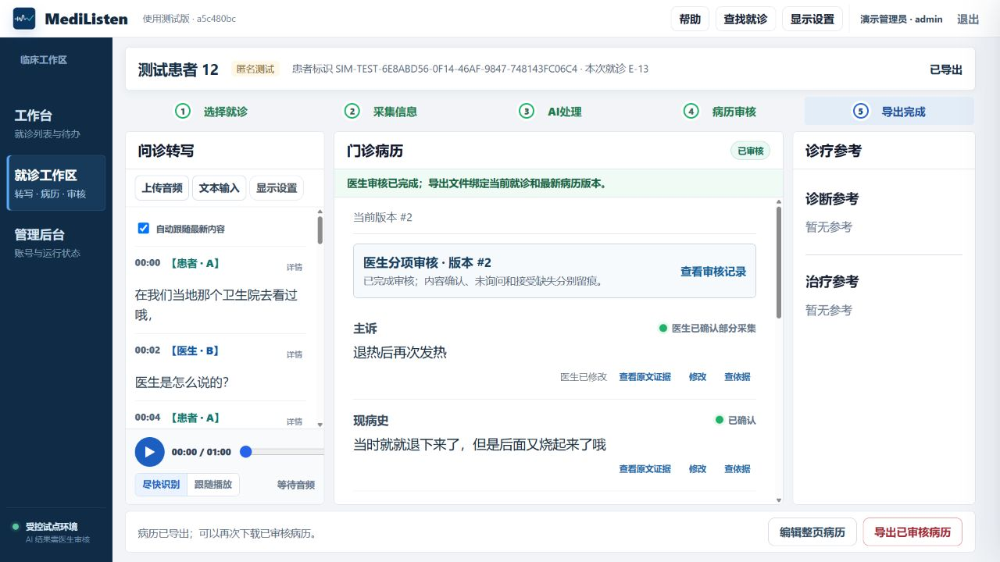
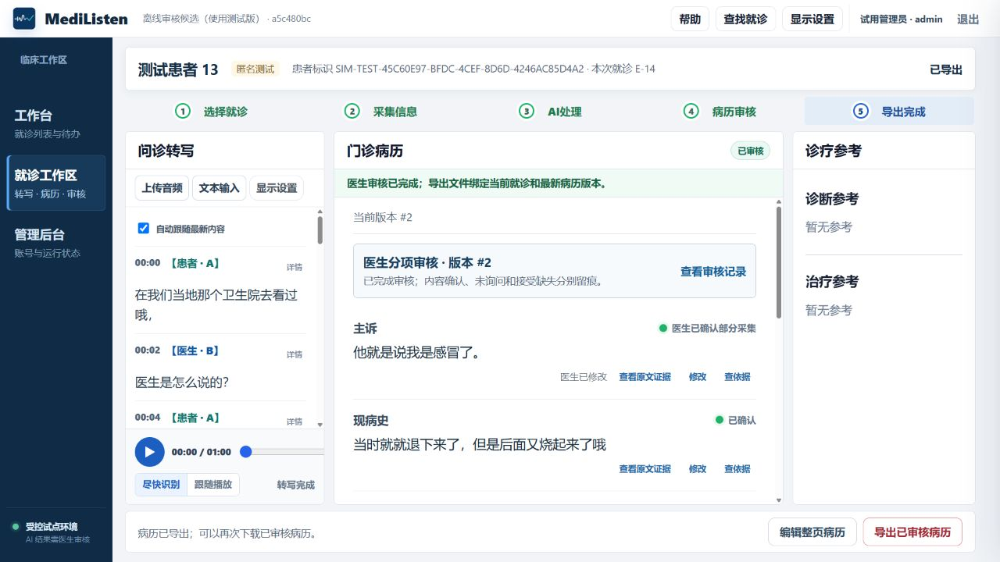
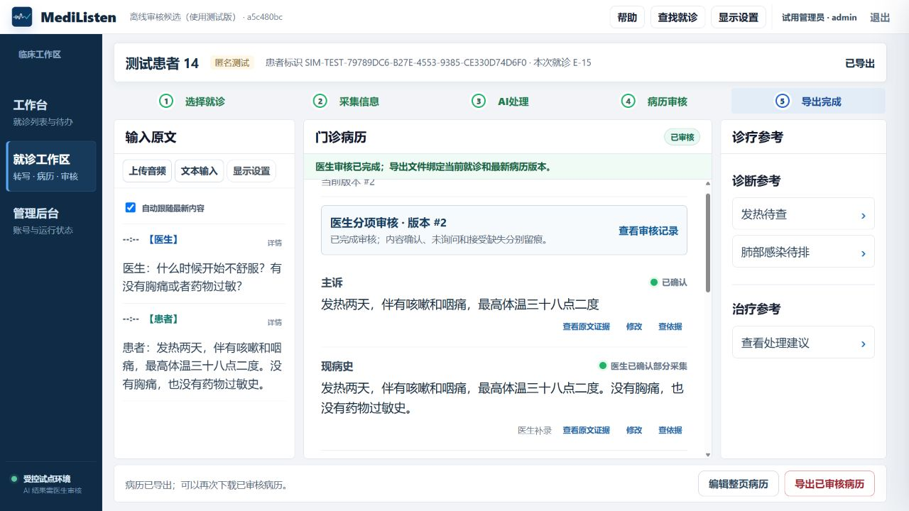
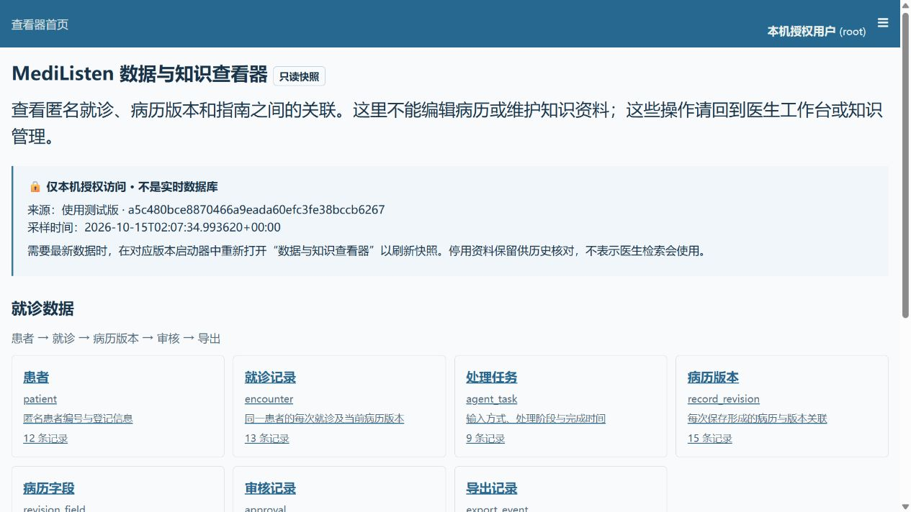

# 8798审核流程候选：响应修复、真实上传与离线恢复

## 交付结论

2026-10-15，8798已更新为`a5c480bce8870466a9eada60efc3fe38bccb6267`。同一镜像在独立离线目录完成真实文本、授权音频的生成、人工核对修改、分项审核、导出与历史重开；恢复后的知识检索与只读查看器可用。交付等级为 **CANDIDATE_NOT_RELEASED（审核流程候选）**。

这不是模型首次质量、临床有效性或稳定医生试用版的放行。物理麦克风、实际浏览器100%/125%/150%显示和后续5.3连续五次仍待验收。本轮由工程执行者使用合成/已授权材料完成界面操作，不是真实医生临床复核。

## 版本与修复边界

| 项目 | 本轮核验值 |
|---|---|
| 发布源码 | `a5c480bce8870466a9eada60efc3fe38bccb6267` |
| 后端登记 | `a5a373fcbd97ff59526e92ce661debbb54a9fe4e`；其后只修改上传前端，后端文件内容与最终发布源码相同 |
| 应用镜像 | `mra51-responsive:a5c480b` |
| 镜像ID | `sha256:b6d91ce683c6c75f1e0143b525bc75985ab13c15a1f3bc423bd2e4d85be6d08e` |
| 选取基线 | `920c3c928ded3630201405b755a48a911d6c31fc`，没有部署开发分支中被拒绝的模型实验 |
| 开发实质提交 | `736a193`响应脱敏调度；`442ba6f`快速上传会话 |
| 模型 | 真实FunASR、本地Ollama/Qwen3:4b；模型权重、提示词和安全阈值未改 |
| 活动入口 | 医生`http://127.0.0.1:8798/static/doctor.html`；查看器本轮实际为8797（8796占用时按既有规则回退） |
| 数据 | 8798原12患者、13就诊、9任务、15病历版本、6批准、8导出；升级前后11张业务/知识表指纹一致 |

两处修复分别有最小复现和独立提交：

1. JSON/SSE响应的身份脱敏在事件循环同步访问SQLite，拖慢同服务其他请求。改用现有Starlette线程池，脱敏内容规则、逐帧顺序和失败保护不变。见[调度与真实负载证据](20261015_response_responsiveness.md)。
2. 快速上传使用旧批量路径，没有ASR会话，角色确认只能只读。两种模式统一复用现有会话上传与角色PATCH；未新增接口或数据库字段。见[快速上传修复](20261015_fast_upload_role_session.md)。

## 同版本真实流程

两条新增流程在恢复副本19002执行，避免将验收数据写入原8798。全程使用页面可见按钮，生成不自动重试；原始结果、规则处理及人工修改分别保留。恢复验证结束后副本停止，8798恢复为唯一活动模型环境。

| 路径 | 首次自动结果与实际处理 | 审核、导出及恢复 |
|---|---|---|
| 授权60秒音频，E-14/任务10 | FunASR真实返回21片段；两名说话人选择患者/医生后可保存；Qwen结果经现有校验后4项有内容、3项缺失。主诉仅作标点修订，未将此算成临床内容正确 | Revision16→17（版本2）；逐项确认及明确接受本次缺失；DOCX/Markdown导出后刷新，21片段、角色、批准及导出状态保留 |
| 合成文本，E-15/任务11 | 3项可核对，现病史引用冲突被隔离，3项缺失；通过“医生补录”将患者原句保存到现病史，保留旧错误版本；排除2项候选诊断 | Revision18→19（版本2）；分项审核、批准、DOCX/Markdown导出；从工作台重开原文、人工来源与批准状态一致 |

文本输入包含发热两天、咳嗽、咽痛、最高体温三十八点二度、否认胸痛和药物过敏。导出内容核对：否定过敏保留，损坏的现病史内容不进入最终正文；缺失历史未自动编造，已排除候选不进入最终病历。音频转写和抽取仍有口语、不完整等质量问题，本轮只确认可核对、修订与追溯的工作流。

本地证据根目录：`.artifacts/asr-responsiveness-20261015/final/`。`audio-first.json`、`text-first.json`保留首次结果；`*-final.json`、`*-final-readiness.json`、DOCX和Markdown保留人工处理后的结果。原始日志、数据库、音频和导出文件不提交Git。

## 并发与工程回归

同一授权音频SHA256：`e0d16a3192b99ee99c74fc730facd22338cd4da2a3bb28da980d6d99375f74a4`。

| 同一单活动环境 | 健康最慢 | 历史读取最慢 | 登录/退出事务最慢 | 失败 |
|---|---:|---:|---:|---:|
| 旧920c3c9，3轮 | 266ms | 1266ms | 11250ms | 1次超时 |
| 最终a5c480bc恢复副本，4轮 | 313ms | 1281ms | 1156ms | 0/12 |

最终ASR处理9.9369秒，21片段；预先固定p95≤2000ms、最大≤5000ms、失败0的本次工程检查通过。登录指标包含登录与退出，不是单个登录接口耗时。一次输入的12次探测不是多医生容量验证、ASR准确率或5.3五次完整流程。最终原始记录为`runtime-final-restored.json`。

- 调度定向10项、上传/角色按钮级定向14项通过。上传自动测试采用Mock ASR，仅验证会话与门禁；上节另列真实FunASR证据。
- 最终发布源码全量：**745通过、2跳过、8子测试通过，524.10秒**；保留1条Windows子进程输出解码警告。独立查看器工具10项通过；前端语法与差异检查通过。
- 同一发布源码第一次全量执行与大归档I/O重叠，报到浏览器测试出现5秒超时：1失败、744通过、2跳过。原日志保留；该文件独立2项通过，停止重I/O后完整重跑取得上项结果。不能写成“从未失败”或据此声称任意负载下稳定。
- 开发分支先前782项全量成绩属于增加快速上传回归之前的代码，不能替最终发布源码成绩。GitHub最新提交CI另以PR记录为准。

开发提交`650aafb`的[GitHub verify](https://github.com/awa606/medical_record_agent/actions/runs/38670102890)已通过：784项Python、2跳过、8子测试、1警告；独立查看器10项；样稿回归76项。CI未执行真实本地模型或物理麦克风。运行候选继续使用上项独立发布源码成绩，两条分支不混算。

10:22单次空闲资源采样：应用4.405GiB、Ollama2.67GiB、网关53.75MiB；主机31.43GiB总内存、4.79GiB可用；GPU8151MiB总量、5992MiB已用。此数据不是峰值或最低配置，多医生并发容量尚未验收。保留单一活动模型环境，未停止无关应用以改变结果。

## 完整包及独立离线恢复

| 内容 | 实际位置/结果 |
|---|---|
| 不可变候选包 | `D:\MediListen_离线归档\response-upload-a5c480b-20261015-r1` |
| 大小/校验 | 221文件，10,990,374,801字节（约10.24GiB）；清单SHA256核对通过 |
| 独立恢复目录 | `D:\MediListen_离线归档\restore-upload-a5c480b-20261015-r1` |
| 恢复端口 | 医生19002、查看器19003；验收完成后已停止恢复应用/模型 |
| 源码与镜像 | 发布源码及Git bundle、应用/Ollama镜像从包内加载，无下载、无构建；源码与镜像一致 |
| 模型与文件 | Qwen、FunASR、BGE完整缓存，许可、匿名数据库、白名单关联文件、Logo、帮助、手册及恢复脚本 |
| 依赖 | 新虚拟环境从包内28个wheel使用`--no-index`安装，不复用原虚拟环境 |
| 隔离 | 所有容器挂载位于新D盘目录；应用、网关、Ollama向公网地址的连接实测被阻断；无原C盘缓存依赖 |
| 数据恢复 | 初始11表与归档指纹一致；两条流程后重启应用，11表仍一致且没有新增生成任务；预热后health/ready200 |

恢复时曾因Docker地址池用尽失败；只移除本轮已结束的19000临时Compose容器和网络，数据目录、镜像和旧包保留，没有全局清理。最终19002恢复成功。原失败包`response-review-a5a373f-20261015-r1`保留其“快速上传角色无法保存”失败证据，不追写为通过。

归档创建后的验证记录作为本报告与本地附件保存，**不回写不可变候选包**。`01_STABLE_BASELINES/response-upload-a5c480b-20261015-r1`只保存候选清单、校验与D盘入口，状态不是稳定发布。

## 知识与数据查看器

- 恢复包4份启用资料、78片段、78语义索引；既有开发20/20、冻结20/20来源命中，200/200引用元数据完整，实际模式`hybrid_v1`。
- 医生通过“查依据”看到真实来源、版本、章节、页码、校验值和离线片段；官网全文链接明确标注需联网。流感2020版不标为最新，儿童资料保留适用范围。没有扩大疾病范围或修改旧检索标签。
- 查看器使用本地认证、匿名白名单快照；中文筛选与文档→29关联片段跳转通过实际按钮验证。未登录、任意SQL、整库下载、写入及敏感账号表访问均被拒绝；医生知识管理403、匿名就诊访问401。
- 原8798查看器最终刷新至**8797**，采样时间**2026-10-15 10:07:34（北京时间）**，来源标识`a5c480bc`。只读快照不冒充实时数据库，浏览未修改业务库。

## 运行、回退与剩余验收

8798现有桌面启动器已重新登记实际镜像和品牌资源指纹，并重新创建当前缺失的`桌面/MediListen 使用测试版.lnk`。快捷方式目标、配置和Logo路径核对通过；启动器构造Smoke及控制器状态均通过，未将其写成原生窗口逐按钮人工验收。帮助实测在当前软件窗口内打开，“返回工作台”关闭后焦点回到帮助按钮，E-13版本2保持。8795、2600、2666和旧2626停止保留。最终部署前后11表指纹相同；页面实测重开原E-13，21片段、版本2与已导出状态恢复。

镜像保留了旧构建链的两套后端标签，控制器采用`org.medilisten.backend.revision=a5a373fc`，前端/发布SHA为`a5c480bc`。旧`patch.scope`标签仍写显示修订，不能用它概括本次实际变更；以精确源码、镜像ID和上述修复文件为准。本轮不改写已校验包的元数据，后续构建统一标签属于交付工具待清理项。

本地回退材料位于`.artifacts/asr-responsiveness-20261015/deployment-before-a5c480b/`（上一a5a版本），`deployment-before/`保留更早920版本的配置、镜像登记与一致性备份。只回退应用时先确认没有录音、生成和未保存修改；不要覆盖已有业务数据。

| 放行项 | 本轮结果 |
|---|---|
| 真实文本、授权音频审核流程 | 2/2通过工程工作流；首次模型质量独立保留失败 |
| 原文恢复、角色保存、Revision、审核、导出和历史重开 | 通过，未放宽冲突或权限门禁 |
| 全量回归、知识检索、数据重启及完整离线恢复 | 通过；失败/警告保留见上文 |
| 物理麦克风新采音 | 待用户稍后配合，未用旧录音替代 |
| 实际100%/125%/150%显示及外屏 | 待验；本轮页面截图不等于实际缩放通过 |
| 5.3同一版本连续五次真实音频流程 | 未启动；需先满足5.1全部验收 |
| 模型首次内容完整性、医院权限/接口及临床验证 | 仍未放行，不能宣称医院企业级或所有输入准确 |

WBS仍为5.1 VERIFY，正式16项、99h、日期和硬件延期不变。下一步集中补齐已约定的最终输入/显示验收，再按顺序进入5.3；不以本轮工程改进提前关闭任务。

## 最终空闲就绪观察

2026-10-15 10:15:24—10:35:27，8798固定a5c480bc连续观察1202.19秒；每60秒采样，共21轮、42次health/ready全部200，无本轮发起的业务生成。结束后原任务仍9个，未新增病历生成任务。健康请求最大172ms、就绪请求最大3094ms；就绪探测包含依赖核验，不与单纯页面请求混用。此结果通过本次20分钟空闲检查，不能代替多医生负载、实际采音或5.3五次流程。原始结果`final/idle-readiness.json`保留。
